## Flow

A Windows optimizer that checks your hardware first, then only applies tweaks that make sense for your machine. Restore point before anything changes, every change logged and revertible.

`Python` `PowerShell` `pywebview` · [Anish-132/Flow-Win-Opt](https://github.com/Anish-132/Flow-Win-Opt) · MIT, no longer maintained

## How I work

- **Measure first.** Flow fingerprints CPU, RAM, disk and GPU before it touches anything. I do the same with bugs: probe, then fix the cause.
- **Everything reversible.** Restore point first, every change logged. If I can't undo it, I don't ship it.
- **Agent reports are claims, not evidence.** After an unattended Claude Code session reported its own fixes, I diffed it. Some files it called unchanged had changed. I audit before I trust.

## The lab

Two laptops, one cable, no router. The HP is a disposable agent sandbox with key-only SSH and no sudo. When the power drops it shuts down cleanly, and the ASUS wakes it when power returns.

## Contact

